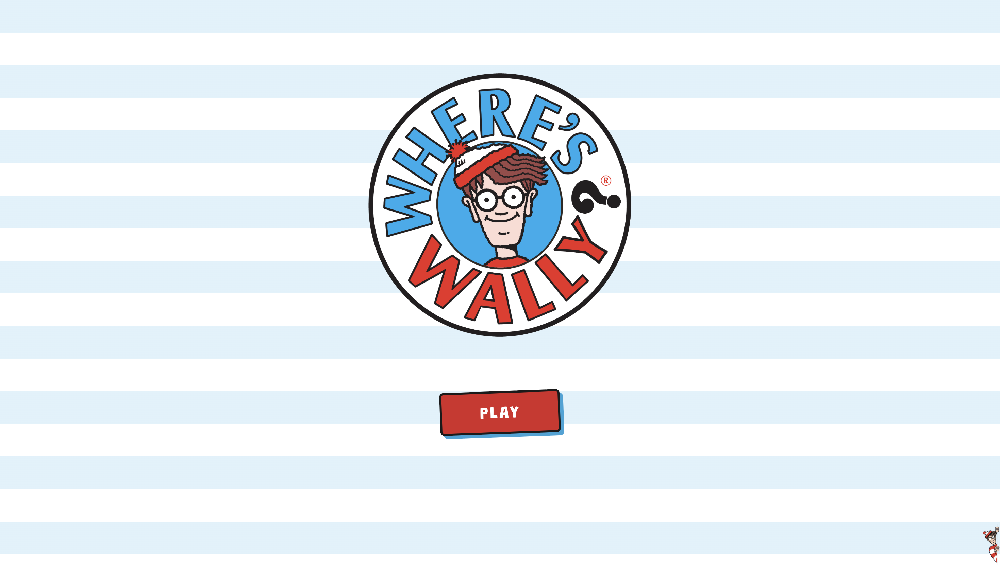
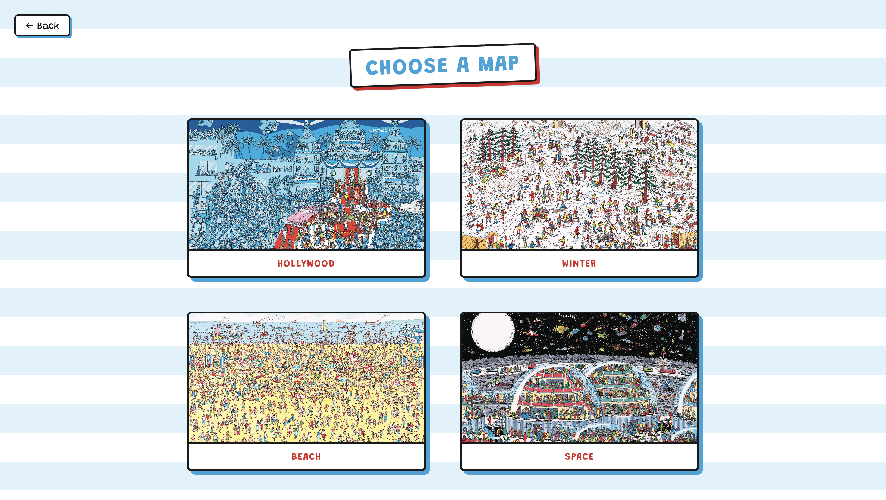
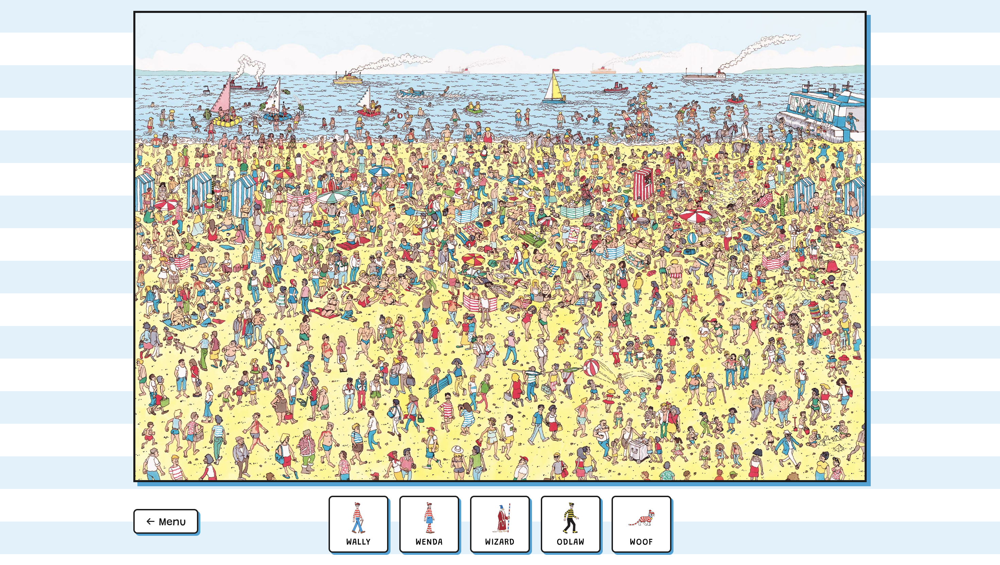
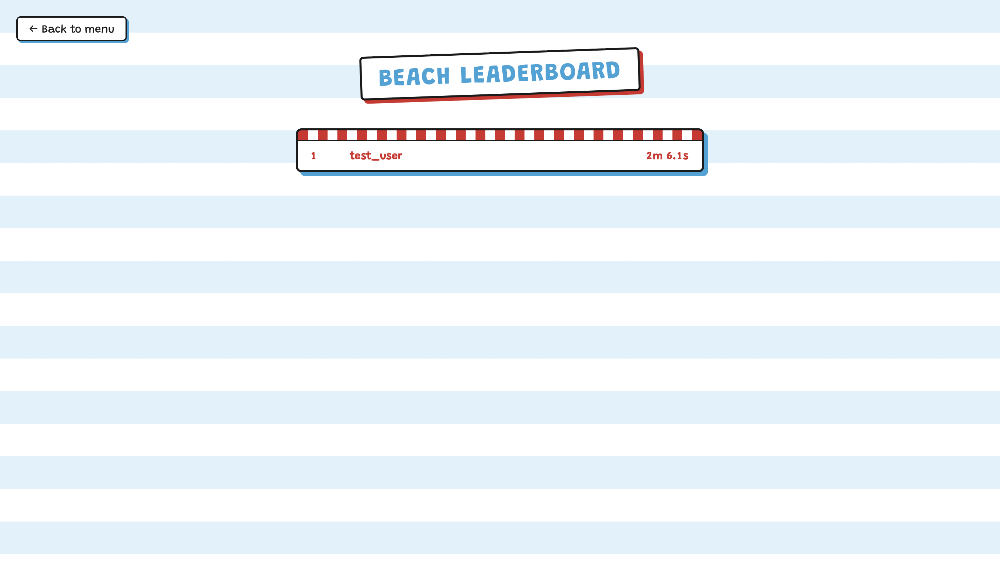

# Where's Wally

A photo tagging game where players search crowded illustrations for hidden characters, racing the clock to get on each map's leaderboard.

🔗 [Live Demo](https://where-is-wally-nine.vercel.app/)

## Screenshots

## Features

- Four maps, each with its own set of characters to find
- Click anywhere on the image to open a targeting circle and pick which character is there
- Clicks are checked on the server, so character positions never reach the browser before they are found
- The game time is measured on the server, from the moment the image loads until the last character is found
- No accounts: each game gets a random UUID, and the player can save a name at the end
- Leaderboard with the best times for each map
- API tests with Vitest and supertest against a separate test database

## How clicks are checked

The client sends each click as a fraction (0–1) of the image's width and height, so it works at any display size. The server turns it into pixels of the original image and checks whether a circle of 50px radius around the click touches the character's box for that map.

Only when a click is correct does the server send back where that character is, so the client can mark it. The positions of the characters still hidden are never sent, so they can't be read from the network tab.

## Built with

- Node.js
- Express
- PostgreSQL (Neon)
- Prisma
- Vitest + supertest
- React
- Vite
- React Router
- CSS Modules

## Credits

Illustrations and characters © Martin Handford. This is a non-commercial learning project.
